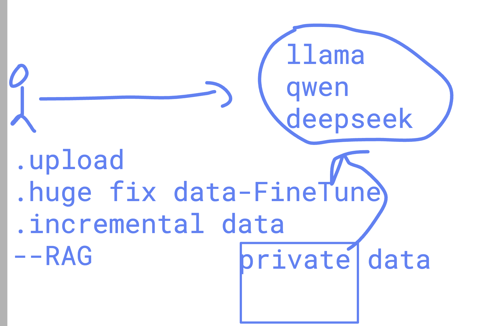
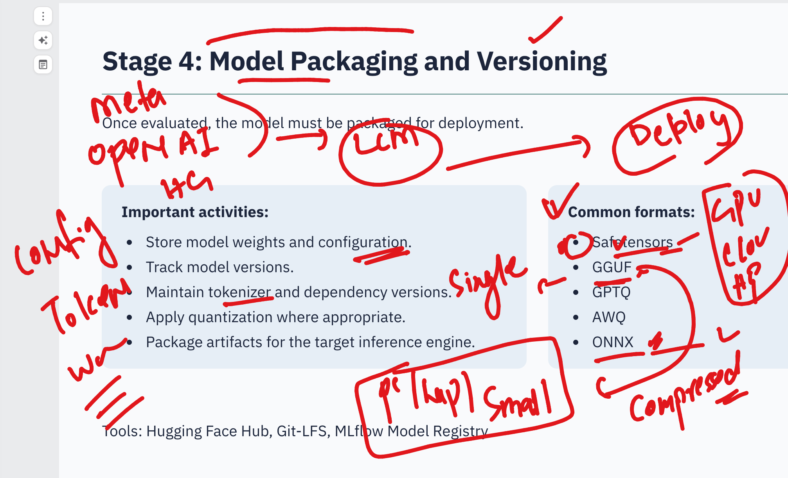
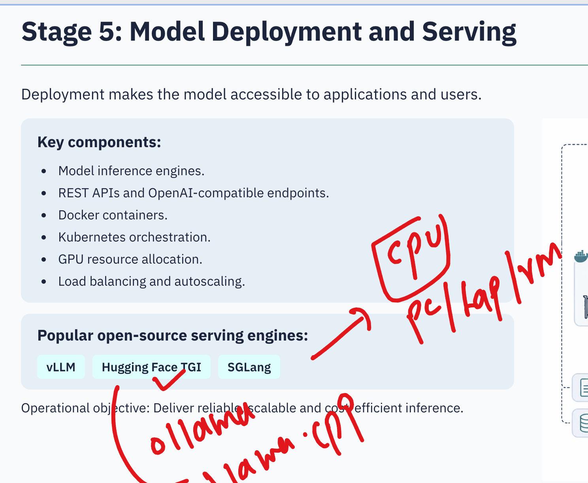
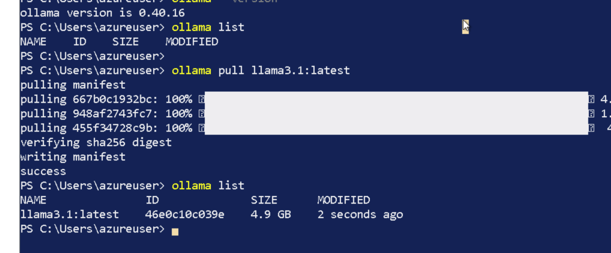
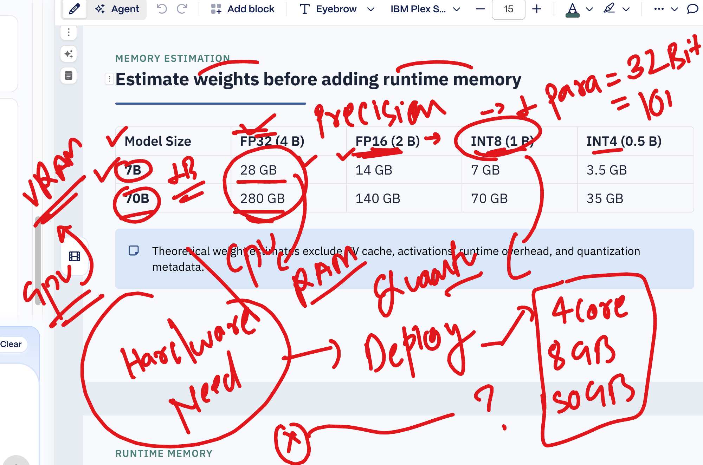
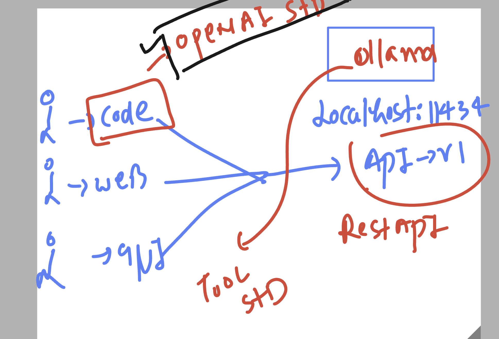
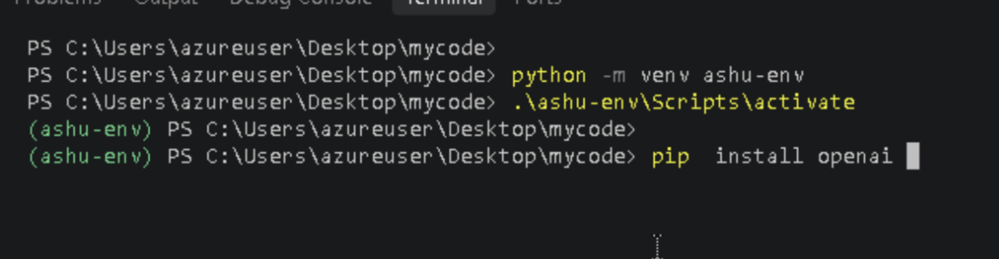

# llmops-walmart-16thNov2026

### Model Develop with custom data options 



### ollama demo

`
root@okk:~# ollama  list
NAME    ID    SIZE    MODIFIED 
root@okk:~# ollama  pull  llama3.1:latest
pulling manifest 
pulling 667b0c1932bc: 100% ▕██████████████████████████████████████████████████████████████████████████████▏ 4.9 GB                         
pulling 948af2743fc7: 100% ▕██████████████████████████████████████████████████████████████████████████████▏ 1.5 KB                         
pulling 455f34728c9b: 100% ▕██████████████████████████████████████████████████████████████████████████████▏  487 B                         
verifying sha256 digest 
writing manifest 
success 
root@okk:~# ollama  list
NAME               ID              SIZE      MODIFIED      
llama3.1:latest    46e0c10c039e    4.9 GB    4 seconds ago    
root@okk:~# ollama  run llama3.1:latest 
>>> 
>>> hello
Hello! How are you today? Is there something I can help you with or would you like to chat?

>>> can you tell me about azure cloud in less than 50 words
Azure is a cloud computing platform and set of services offered by Microsoft. It provides a range of services, including computing, 
storage, networking, and analytics, allowing users to build, deploy, and manage applications and services through a global network of 
data centers. It's highly scalable and secure.


### history 

```
  1  apt update
    2  curl -fsSL https://ollama.com/install.sh | sh
    3  systemctl status ollama.service 
    4  ls /home/
    5  grep -i oll /etc/passwd
    6  clear
    7  ollama list
    8  free -m
    9  lscpu 
   10  exit
   11  free -m
   12  lscpu 
   13  ollama  list
   14  ollama  pull  llama3.1:latest
   15  ollama  list
   16  ollama  run llama3.1:latest 
   17  ollama  ps

```

### Model package 



### model deployment / inferencing options 




### pulling model to local system using ollama 



### some model sizing -- hardware need understanding 



### openai std or tool std to call the model 




### creating Virtual env in python on windwos vscode install openAI




### Connecting ollama hosted model using python 


### Multi GPU support to deploymodel 

--> GPU -- VRAM --(weight ,cache , token)

