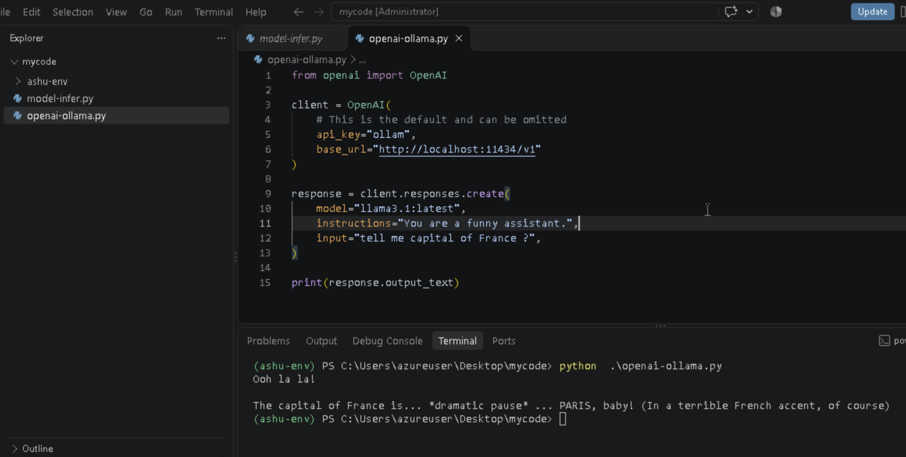
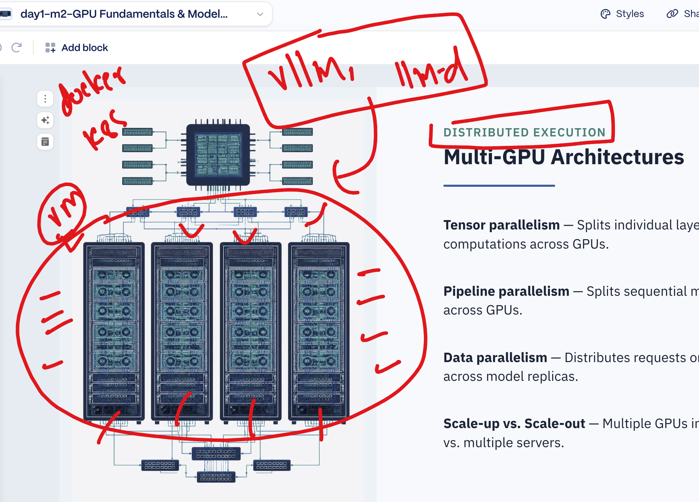
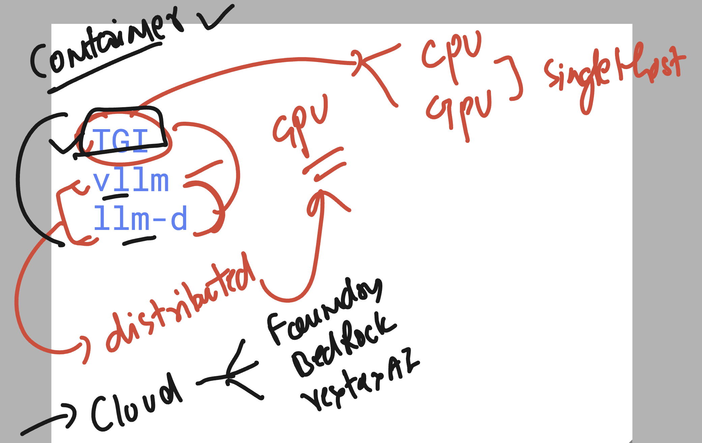

# llmops-walmart-16thNov2026

### Model Develop with custom data options 


### ollama demo

`
root@okk:~# ollama  list
NAME    ID    SIZE    MODIFIED 
root@okk:~# ollama  pull  llama3.1:latest
pulling manifest 
pulling 667b0c1932bc: 100% ▕██████████████████████████████████████████████████████████████████████████████▏ 4.9 GB                         
pulling 948af2743fc7: 100% ▕██████████████████████████████████████████████████████████████████████████████▏ 1.5 KB                         
pulling 455f34728c9b: 100% ▕██████████████████████████████████████████████████████████████████████████████▏  487 B                         
verifying sha256 digest 
writing manifest 
success 
root@okk:~# ollama  list
NAME               ID              SIZE      MODIFIED      
llama3.1:latest    46e0c10c039e    4.9 GB    4 seconds ago    
root@okk:~# ollama  run llama3.1:latest 
>>> 
>>> hello
Hello! How are you today? Is there something I can help you with or would you like to chat?

>>> can you tell me about azure cloud in less than 50 words
Azure is a cloud computing platform and set of services offered by Microsoft. It provides a range of services, including computing, 
storage, networking, and analytics, allowing users to build, deploy, and manage applications and services through a global network of 
data centers. It's highly scalable and secure.


### history 

```
  1  apt update
    2  curl -fsSL https://ollama.com/install.sh | sh
    3  systemctl status ollama.service 
    4  ls /home/
    5  grep -i oll /etc/passwd
    6  clear
    7  ollama list
    8  free -m
    9  lscpu 
   10  exit
   11  free -m
   12  lscpu 
   13  ollama  list
   14  ollama  pull  llama3.1:latest
   15  ollama  list
   16  ollama  run llama3.1:latest 
   17  ollama  ps

```

### Model package 


### model deployment / inferencing options 


### pulling model to local system using ollama 


### some model sizing -- hardware need understanding 


### openai std or tool std to call the model 


### creating Virtual env in python on windwos vscode install openAI


### Connecting ollama hosted model using python 



### Multi GPU support to deploymodel 

--> GPU -- VRAM --(weight ,cache , token)




### Hugging face Model deployment options 



### Deploy model gguf format using docker container / TGI / llama.cpp

```
 35  mkdir -p ~/llama-cpu/models
   36  cd ~/llama-cpu/models
   37  curl -L   "https://huggingface.co/mfuntowicz/SmolLM2-360M-Instruct-Q4_K_M-GGUF/resolve/main/smollm2-360m-instruct-q4_k_m.gguf"   -o smollm2-360m-instruct-q4_k_m.gguf
   38  ls
   39  ls -lh
   40  ls -lh ~/llama-cpu/models/smollm2-360m-instruct-q4_k_m.gguf
   41  docker run -d   --name llama-cpu   --restart unless-stopped   --cpus=4   --memory=6g   -p 8080:8080   -v ~/llama-cpu/models:/models:ro   ghcr.io/ggml-org/llama.cpp:server   -m /models/smollm2-360m-instruct-q4_k_m.gguf   --host 0.0.0.0   --port 8080   -c 2048   -t 4
   42  docker ps


```

### curl to connect 

```
curl http://localhost:8080/v1/chat/completions   -H "Content-Type: application/json"   -d '{
   46      "model": "SmolLM2-360M-Instruct",
   47      "messages": [
   48        {
   49          "role": "user",
   50          "content": "Explain LLMOps in simple terms with one enterprise example."
   51        }
   52      ],
   53      "temperature": 0.7,
   54      "max_tokens": 200
   55    }'`

```

### Understanding RAG 


