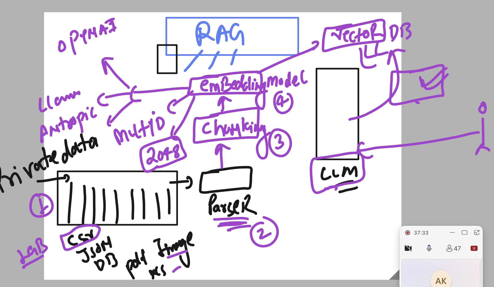

# llmops-walmart-16thNov2026

### Revision process 1 


### revision process 2 


### RAg process 



### ssh access 

```
ssh  azureuser@48.214.147.119
The authenticity of host '48.214.147.119 (48.214.147.119)' can't be established.
ED25519 key fingerprint is: SHA256:RKvZBqsJRoR5om1R/eB14RLohk/rj2ZpbA3flloOqTI
This key is not known by any other names.
Are you sure you want to continue connecting (yes/no/[fingerprint])? yes
Warning: Permanently added '48.214.147.119' (ED25519) to the list of known hosts.
azureuser@48.214.147.119's password: 
Welcome to Ubuntu 24.04.5 LTS (GNU/Linux 7.0.0-1020-azure x86_64)

 * Documentation:  https://help.ubuntu.com

```